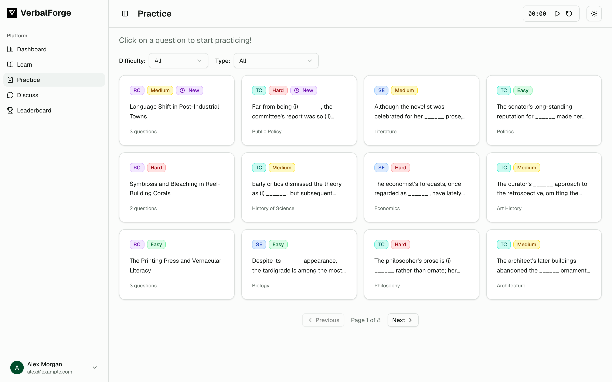
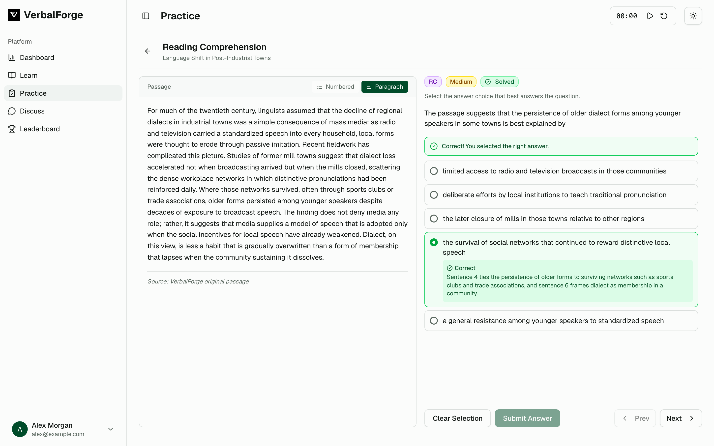

# VerbalForge Frontend

VerbalForge is a GRE verbal practice platform whose questions are generated by an LLM pipeline. This repository is the web app: a Next.js frontend where students practice text completion, sentence equivalence, and reading comprehension questions, and admins review and publish generated content.

Live site: https://www.verbalforge.xyz (may be offline)





*Screenshots use demo data and a made-up user.*

## What this repo does

- **Practice**: browse and filter questions and passages by type and difficulty, answer them with a timer, and see explanations after submitting.
- **Learn**: vocabulary word cards with per-word recall status.
- **Discuss**: threaded discussions and comments on questions.
- **Dashboard and leaderboard**: per-user stats, activity calendar, and rankings.
- **Admin**: review, edit, and publish generated questions and passages; manage words, FAQs, feedback, support tickets, discussions, and users.
- **Auth**: email/password and Google sign-in.

All data comes from the [verbalforge-backend](https://github.com/VerbalForge/verbalforge-backend) REST API through `src/lib/services`.

## Stack

Next.js 15 (App Router, `output: "standalone"`), React 19, TypeScript, Tailwind CSS 4, shadcn/ui (Radix), Recharts, Tiptap, React Hook Form with Zod, Sonner.

## Run locally

Requires Node.js 20.18.0 (see `.nvmrc`) and a running backend.

```bash
npm ci
npm run dev
```

Environment variables (set in `.env.local`):

| Variable | Purpose |
| --- | --- |
| `NEXT_PUBLIC_API_URL` | Backend base URL. Defaults to `http://localhost:8080`. |
| `NEXT_PUBLIC_GOOGLE_CLIENT_ID` | Google OAuth client ID for Google sign-in. |

Other scripts: `npm run build` (production build) and `npm run lint` (ESLint). Because the build uses standalone output, start a production build with `node .next/standalone/server.js` rather than `npm start`, with `public` and `.next/static` copied into the standalone output.

## Project layout

```
src/app          App Router pages (user pages under [username]/, admin/)
src/components   Feature components; ui/ holds shadcn primitives
src/contexts     React context providers (auth)
src/hooks        Reusable hooks
src/lib          API client, services, and domain models
```

## Related repositories

| Repo | Role |
| --- | --- |
| **verbalforge-frontend** (this repo) | Next.js practice and admin UI |
| [verbalforge-backend](https://github.com/VerbalForge/verbalforge-backend) | Go/Gin REST API over MongoDB: auth, practice, progress, discussions, admin |
| [verbalforge-ai](https://github.com/VerbalForge/verbalforge-ai) | Python workers that generate and validate questions and write them to MongoDB |
